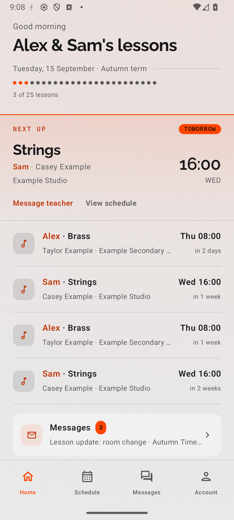
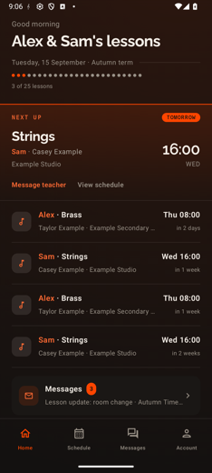
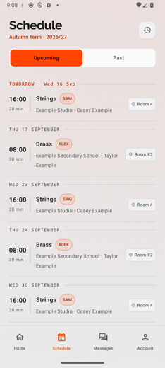
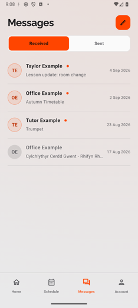
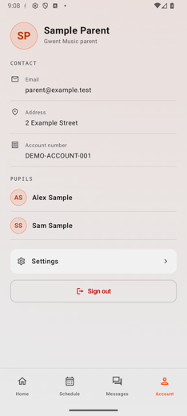
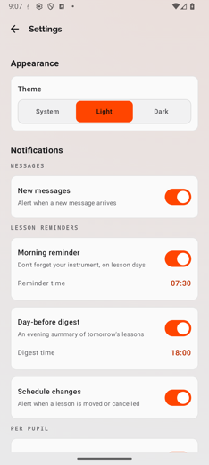

# Gwent Music Companion

Native Android companion for the Gwent Music parent experience, built with Kotlin,
Jetpack Compose and the Paritor / Xperios API. This is an independent project, not
an official Paritor or Gwent Music application.

## Status: archived reference implementation

This is a reference implementation, not a working app. I built it as a parent to
reach my own Gwent Music information from my phone alongside the web portal. It was
written against an earlier version of the Paritor / Xperios API that a client could
reach directly. That route has since been closed by the provider, so the code will
not function as-is today and a build cannot reach real Gwent Music data. As I
understand it the provider intends to ship their own official app, which is the
right home for this.

I am sharing the source as a reference for how the app was built: a native Android
client with no WebView, an offline snapshot cache that shows how current the data
is, on-device notifications, light and dark theming and an automated test suite.
Publishing the source does not authorise distributing a build that carries a
credential.

The optional CDN updater is documented in [UPDATER.md](UPDATER.md), including its
release workflow and removal instructions.

## Screenshots

Seeded mock data, no real information. Light and dark are the app's own in-app theme.

<table>
  <tr>
    <td align="center"><br>Home (light)</td>
    <td align="center"><br>Home (dark)</td>
    <td align="center"><br>Schedule</td>
  </tr>
  <tr>
    <td align="center"><br>Messages</td>
    <td align="center"><br>Account</td>
    <td align="center"><br>Settings</td>
  </tr>
</table>

## Lesson history

History initially shows up to four recent term groups. **Load more** explicitly adds
up to four older groups; scrolling and collapsing terms never trigger requests.
Requests still use small date windows to avoid one expensive whole-history query.
Discovery searches at most eight windows, including gaps. The selected groups then
continue loading through their service-provided term start dates before Load more
becomes available. Additional groups found during completion stay hidden until the
next batch. Unavailable or inconsistent term dates leave the current batch retryable,
not silently complete. Ad-hoc groups without a term ID are labelled **Loaded lessons
only** because no term boundary exists; these do not block browsing older history.
Retry keeps successful pages and repeats the failed window or metadata lookup.
There is no five-year retention cutoff in the app. Availability of older data
still depends on the service. Loaded history stays in memory while the screen's
ViewModel remains alive and is fetched again after a fresh visit or app restart.

## Build and test without a live account

Use JDK 21 and Android SDK platform 37 (`platforms;android-37.0`). Versions are pinned in
`gradle/libs.versions.toml`; use the checked-in Gradle wrapper. Configure `sdk.dir`
in ignored `local.properties` if `ANDROID_HOME` does not identify your SDK.

```sh
./gradlew :app:assembleDebug
bash scripts/check.sh
```

The full check runs tests, coverage floors, lint, debug and minified release builds,
dependency notices, Python tests and Go race/vet checks. See [TESTING.md](TESTING.md)
for the coverage inventory and the boundaries of automated validation.

The default debug build uses the local mock API, not production. Start it in another
terminal with Go 1.26 or later:

```sh
cd mockserver
go run .
```

Run the app in an Android emulator and select "Use seeded mock data". The emulator
reaches the host API at `http://10.0.2.2:8099/`. No customer API key or parent login
is required. See [mock API instructions](mockserver/README.md). Minimum Android API
is 28; target API is 37. Physical-device networking needs separate configuration.

## Architecture

- UI: Compose screens consume ViewModel state through lifecycle-aware collection.
- Data: `GwentRepository` combines Retrofit API responses into screen models.
- Authentication: custom `LoopbackAuth` uses a system-browser Custom Tab and
  the authorisation-code flow with PKCE against Schooble B2C. It is not AppAuth and does not
  use a WebView. Tokens use Keystore-backed encrypted preferences.
- Background work: WorkManager provides best-effort polling and local reminders.
  Scheduling is not exact and can be delayed by Android power management.
- Tests: parsing/planning tests and local Android regression coverage. See
  [contributor guidance](CONTRIBUTING.md) for expected failure-path coverage.

Source is under `app/src/main/java/org/bayton/gmc/`: `ui/`, `data/`, `di/` and
`notify/`. Each screen keeps its last good data in an owner-keyed DataStore
snapshot, so it can show the previous content with a freshness state while a
refresh runs or after one fails. Room is not used; snapshot reads are wholesale.

## Live API and release precautions

Live access requires authorised credentials. Never paste keys, tokens, HAR files,
parent records or message contents into source, issues, fixtures or logs.

For authorised local testing only, put `GWENT_API_KEY` in ignored `local.properties`
and build with `-PGMC_LIVE=true`. This switches debug to the live API. Do not use
live accounts for automated tests or CI.

**Current personal-build exception:** release builds automatically embed a key
when present in `local.properties` or supplied as a Gradle property. They also use
debug signing. Do not distribute these APKs. A clean checkout without a key builds
keyless. Supported runtime credential provisioning is required before distribution.

The live client enforces fresh bearer credentials and attaches the configured API
key when available. Use only supported credentials for accounts you are authorised
to access. Integration approval, account isolation, privacy and production signing
remain distribution requirements. Notifications use nominal
30-minute local checks plus immediate post-sign-in sync, without a delivery deadline.

## Licence

Project-authored code is available under the [MIT licence](LICENSE). Third-party
dependencies and assets retain their own licences. See [third-party notices](THIRD_PARTY_NOTICES.md)
for verified font/artwork provenance and bundled font licences. MIT does not replace
those terms. Report vulnerabilities privately using the [security policy](SECURITY.md).
